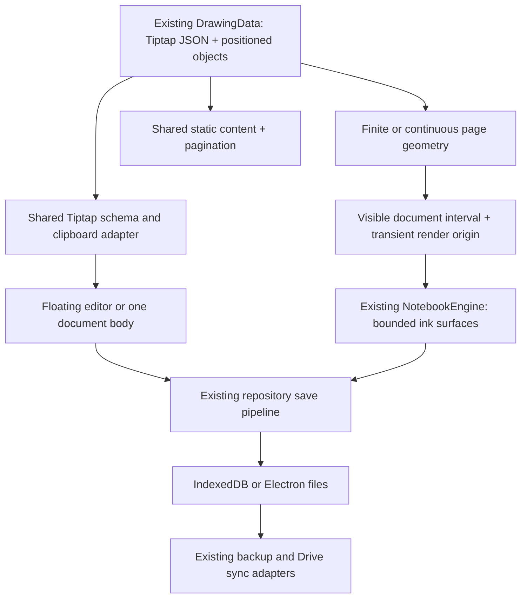

# Panvas documentation engine and infinite pages: research, audit, and implementation plan

**Date:** 9 October 2026. **Audited checkout:** main, a1f301797a72eac165ca37afb87df2bd78c3b695, Panvas 0.1.7.

**Status: planning only, awaiting explicit approval.** Application code, dependencies, storage, and user workspaces were not changed. The report and ignored local audit artifacts are the only intended additions.

## Recommendation

Extend the existing shared Tiptap schema and keep rich text in TextObject.content. Give flowing pages one identified document-body TextObject inside the existing DrawingData.objects collection. Keep positioned text, ink, shapes, and images alongside it. Separate page height mode from layout mode; add continuous geometry backed by bounded drawing surfaces, rather than enlarging the current whole-page canvas.

The existing foundation already provides most basic formatting, structured lists, tables, and active-editor code highlighting. The first work should repair conversion fidelity and protect non-text content, then complete missing nodes and asset portability. Continuous geometry should precede exposing document flow, because the current page frame clips content and the drawing renderer assumes a finite page. PDF pagination must be completed before Infinite becomes a supported user-facing option.

The largest risks are asset recovery, scroll/coordinate stability, whole-document work on every change, and PDF fidelity. They are more consequential than adding toolbar buttons.

## 1. Research: documented Notion behavior and Panvas equivalents

Sources were checked against current official help and developer documentation. “Documented” below means a published behavior, not independent hands-on acceptance of Notion. Recommendations describe Panvas implementation choices.

### Formatting and blocks

| Area | Documented Notion behavior | Recommended Panvas equivalent |
| --- | --- | --- |
| Paragraphs and headings | Paragraph blocks and H1, H2, H3; headings can be collapsible. [Headings and tables](https://www.notion.com/help/columns-headings-and-dividers) | Retain Panvas H1–H6. Add collapsible containers using the existing ProseMirror tree; heading-level support is already broader than Notion. |
| Inline formatting | Bold, italic, underline, strike, inline code, and links are supported. [Editing basics](https://www.notion.com/help/writing-and-editing-basics), [rich-text API](https://developers.notion.com/reference/rich-text) | Reuse existing marks and commands. Preserve multiple simultaneous marks during HTML normalization. |
| Colors and alignment | Text/background colors, page font choices, and full-width layout are documented. Traditional paragraph alignment is currently absent according to the help FAQ. [Page styling](https://www.notion.com/help/customize-and-style-your-content) | Keep existing left/center/right/justify, colors, highlights, and fonts. No reason to remove Panvas capabilities to match Notion. |
| Lists and checkboxes | Bullets, numbering, nesting, and to-do blocks; toggles, quotes, and dividers are available. [Editing basics](https://www.notion.com/help/writing-and-editing-basics) | Existing bulletList, orderedList, listItem, taskList/taskItem, blockquote, and horizontalRule already supply the structural foundation. Add details containers for collapse. |
| Callouts | Icon-bearing containers can hold further content. Page icons and covers are optional presentation. [Page styling](https://www.notion.com/help/customize-and-style-your-content) | A small Tiptap callout node with icon/tone attributes and nested block content. Optional document presentation belongs in existing page metadata and asset storage. |
| Simple tables | Row/column insertion, resizing, headers, width fitting, and merged cells. The current help says multi-cell paste is unsupported; merging keeps the anchor cell and clears the others. [Tables](https://www.notion.com/help/columns-headings-and-dividers) | Reuse installed Tiptap tables. Expose commands later and test actual cell selection, resizing, paste, and merge/undo. Require Panvas to preserve cell content; do not copy the documented destructive merge policy. |
| Table of contents | A derived heading index can be a block or a page-level navigation element. [TOC](https://www.notion.com/help/columns-headings-and-dividers) | Extend existing notebook outline extraction with stable heading identifiers and within-page navigation. Derive labels from headings rather than maintaining duplicate text. |
| Block actions | Slash insertion, conversion menus, drag handles, duplication, deletion, and keyboard block movement. [Editing basics](https://www.notion.com/help/writing-and-editing-basics), [keyboard shortcuts](https://www.notion.com/help/keyboard-shortcuts) | Extend the existing slash suggestion and ProseMirror transactions. Start with keyboard-accessible conversion/movement; a visible handle is later UI work. No separate block database. |
| Markdown shortcuts | Typing shortcuts create headings, lists, checks, and other formatting; keyboard shortcuts handle formatting and block operations. [Editing basics](https://www.notion.com/help/writing-and-editing-basics), [keyboard shortcuts](https://www.notion.com/help/keyboard-shortcuts) | Retain StarterKit input/paste rules. Distinguish typing shortcuts from parsing an entire pasted Markdown document. |

The developer API represents ordered child blocks and rich inline segments, with explicit attributes such as code language and equation expression. This is a useful interoperability model, but does not establish Notion's private editor or rendering architecture. [Block API](https://developers.notion.com/reference/block), [rich-text API](https://developers.notion.com/reference/rich-text)

### Technical content

| Area | Documented behavior | Panvas direction |
| --- | --- | --- |
| Code | Language selection and syntax highlighting, optional line wrapping, raw-code copy, and captions. [Code blocks](https://www.notion.com/help/code-blocks) | Keep CodeBlockLowlight and explicit language metadata. Add language selection, copy, and wrap controls later; fix preview parity first. |
| Mathematics | Editable inline/display equations use KaTeX's supported LaTeX subset. Copying inline LaTeX yields source code. [Math equations](https://www.notion.com/help/math-equations) | Use the official Tiptap mathematics nodes with existing KaTeX. Persist LaTeX source, not generated HTML. |
| Images/media | Images can be uploaded or referenced by URL, inserted as blocks, resized, linked, and described with alt text. Other media types exist. [Images and media](https://www.notion.com/help/images-files-and-media) | Start with notebook inline/block images backed by Panvas's existing asset repository. Video embeds and arbitrary remote frames are not prerequisites. |
| Internal references | Links can target pages or individual blocks. [Links and backlinks](https://www.notion.com/help/create-links-and-backlinks) | Store explicit local page/block targets and route through notebook navigation. People mentions and backlink infrastructure are outside the required scope. |
| Markdown import | .md/.txt import is supported; standard headings, lists, and code are documented, with limitations for anchors and nonstandard extensions. [Import](https://www.notion.com/help/import-data-into-notion) | Import to Tiptap JSON through one adapter. Preserve a supported subset and report unsupported constructs. |
| Markdown export | Non-database content can export as Markdown with assets; callouts use HTML because core Markdown lacks an equivalent. [Export](https://www.notion.com/help/export-your-content) | Export Markdown plus an asset folder/archive where needed. Use safe HTML for nonstandard blocks and explain portability limits. Structured backup remains the full-fidelity format. |

### Clipboard: what the sources establish

The official documentation establishes code copying, LaTeX source copying, file import, and general editing features. It does **not** establish a public MIME precedence contract, reliable conversion of every ChatGPT copy button, universal equation/image/table fidelity, or Notion's exact HTML parser.

Consequently:

- Browser selection copy, a “Copy code” action, and an assistant's “Copy response” action must be tested separately. They may supply different HTML/plain-text representations.
- HTML can carry semantic headings, lists, tables, code classes, and equation annotations. Plain text cannot recover marks or missing math source.
- Explicit code language should be retained when supplied. Neither adjacent prose nor automatic detection is a reliable language contract.
- A rendered formula with no LaTeX/MathML source cannot safely be reconstructed by guessing. Preserve readable fallback text and disclose the limitation.
- Unsupported content must not disappear silently. Preserve the original available text or source and report the unsupported feature.

These are **Panvas design rules inferred from available representations**, not claims that Notion guarantees them. The current audit's clipboard samples are synthetic; no claim is made that live ChatGPT, GitHub, or Notion clipboard output was accepted end to end.

### Layout and long documents

Notion documents present ordered, flowing content, with default/full-width presentation choices and resizable content. This suggests normal document flow with stable block identity. [Page styling](https://www.notion.com/help/customize-and-style-your-content), [block API](https://developers.notion.com/reference/block)

The sources do not reveal a current virtualization algorithm, canvas strategy, unlimited memory behavior, or a numerical performance guarantee. Panvas must measure its own DOM, persistence, and ink costs. A fixed A4-width notebook document is a deliberate Panvas choice; it does not require reproducing Notion's width options.

### Relevant open-source mechanisms

ProseMirror exposes clipboard HTML transformation, custom clipboard parsing, plain-text parsing, and pasted slices. Use these hooks inside the existing editor instead of letting workspace paste and active-editor paste evolve independently. [ProseMirror reference](https://prosemirror.net/docs/ref/)

Tiptap's Markdown package provides JSON parsing/serialization and extension handlers, but is currently documented as **Beta**. Its documented Markdown-table limitation is one child node per cell. This needs a compatibility spike, especially for custom nodes and multi-block table cells. [Tiptap Markdown](https://tiptap.dev/docs/editor/markdown)

Official mathematics and details extensions fit the current schema. Math stores source in node attributes; details uses summary/content children and configurable open-state persistence. Their live node views do not automatically establish static-preview or export fidelity. [Mathematics](https://tiptap.dev/docs/editor/extensions/nodes/mathematics), [Details](https://tiptap.dev/docs/editor/extensions/nodes/details)

For performance, Tiptap recommends isolating editor React rendering and managing transaction-driven rerenders; React node views can be expensive. This is not a license to unmount arbitrary editable paragraphs during selection or IME composition. [Tiptap performance](https://tiptap.dev/docs/guides/performance)

Marked does not sanitize imported HTML. Use an explicit sanitizer at the input boundary. Keep KaTeX trust disabled and constrain expansion/size. [Marked security guidance](https://marked.js.org/), [DOMPurify](https://github.com/cure53/DOMPurify), [KaTeX security](https://katex.org/docs/security)

## 2. Existing Panvas capabilities and observed gaps

File links are relative to this report; line numbers describe the audited commit. “Runtime” means executed with actual editor/browser code. “Source” means the implementation was inspected without complete user-journey acceptance.

### Editor and content matrix

| Capability | Current status and evidence | Main reference |
| --- | --- | --- |
| Structured rich text | Implemented: TextObject.content stores Tiptap JSON; live changes update the existing text manager and save pipeline. Runtime HTML→JSON→Editor round trip retained the tested structure. | [FloatingTextEditor.tsx:109–126](../../src/components/notebook/FloatingTextEditor.tsx#L109), [drawingTypes.ts:104](../../src/components/notebook/engine/drawingTypes.ts#L104) |
| Headings and basic marks | Implemented: H1–H6, bold, italic, underline, strike, inline code, links. Runtime sample retained these semantic elements, including H6. H1–H3 are exposed in the current slash menu/toolbar. | [tiptapExtensions.ts:42](../../src/components/notebook/tiptapExtensions.ts#L42), [slashSuggestion.ts:7](../../src/components/notebook/slashSuggestion.ts#L7) |
| Font, color, highlight, alignment | Registered and exposed through existing formatting controls. Combined CSS-style paste is faulty: one span with bold+italic+underline+color retained only bold in the runtime sample. | [tiptapExtensions.ts:42–96,102–212](../../src/components/notebook/tiptapExtensions.ts#L42), [NotebookFloatingToolbar.tsx:1289](../../src/components/notebook/NotebookFloatingToolbar.tsx#L1289) |
| Lists and checks | Structured bullet/ordered/nested lists and task nodes already exist. Runtime nested bullets and a checked task were retained. Broader editing/cell-selection acceptance is still required. | [tiptapExtensions.ts:42](../../src/components/notebook/tiptapExtensions.ts#L42) |
| Quotes and dividers | Existing schema; runtime sample retained both. Slash exposes quote, but the insertion menu does not cover every registered block. | [slashSuggestion.ts:7–74](../../src/components/notebook/slashSuggestion.ts#L7) |
| Tables | Table/row/header/cell extensions and resizable table support already exist. Runtime HTML table retained cells. No complete table command UI or editing test journey was found. | [tiptapExtensions.ts:42](../../src/components/notebook/tiptapExtensions.ts#L42) |
| Code blocks | Existing CodeBlockLowlight, explicit language attribute, registered common languages and plaintext default. Active-editor highlighting produced tokens in the runtime probe. | [tiptapExtensions.ts:24,42](../../src/components/notebook/tiptapExtensions.ts#L24) |
| Code preview/paste | Partial: static generateHTML output lacks Lowlight decoration tokens. HTML class hljs-python became python through workspace import but plaintext inside the active editor. A preceding paragraph “warning” was incorrectly used as a language by workspace normalization. | [StaticTextPreview.tsx:50](../../src/components/notebook/StaticTextPreview.tsx#L50), [tiptapExtensions.ts:102](../../src/components/notebook/tiptapExtensions.ts#L102) |
| Slash commands | Implemented Suggestion-based menu: text, sticky note, H1–H3, bullet list, to-do, quote, code. Missing menu entries are often UI gaps rather than missing schema. | [SlashMenuExtension.ts:4](../../src/components/notebook/SlashMenuExtension.ts#L4), [slashSuggestion.ts:7](../../src/components/notebook/slashSuggestion.ts#L7) |
| Markdown | Partial: StarterKit formatting rules and a workspace-only parser for closed three-backtick code fences. Prose remains plain paragraphs; unsupported language identifiers are dropped. Active-editor sample kept headings/fences literal while an inline bold paste rule fired. | [NotebookRenderer.tsx:58–62,123–169](../../src/components/notebook/NotebookRenderer.tsx#L123) |
| .md interoperability | No notebook structured Markdown import/export pipeline found. Excalidraw MarkdownBlock is a separate preview/raw-text component; Knowledge .md files are a separate subsystem. | [MarkdownBlock.tsx:133](../../src/components/canvas/MarkdownBlock.tsx#L133), [knowledge-service.ts](../../electron/ipc/knowledge-service.ts), [UniversalDropRouter.ts](../../src/services/drop/UniversalDropRouter.ts) |
| Clipboard HTML | Partial: workspace HTML calls sanitizeHtml/generateJSON; active contenteditable deliberately uses native Tiptap paste instead. Image-file precedence can consume a mixed rich clipboard before its HTML. The runtime paths differ. | [NotebookRenderer.tsx:1829–1899](../../src/components/notebook/NotebookRenderer.tsx#L1829), [FloatingTextEditor.tsx:109](../../src/components/notebook/FloatingTextEditor.tsx#L109) |
| HTML safety | Current cleaner removes several unsafe elements and unsafe link hrefs, but the probe retained onclick/onerror attributes in its returned HTML. Missing DOMParser/errors return raw input. This is an incomplete sanitizer boundary, not proof of executable XSS in the current restricted schema. | [tiptapExtensions.ts:102–226](../../src/components/notebook/tiptapExtensions.ts#L102) |
| Inline images | Missing in notebook rich text: image extension is installed but not registered. Runtime image HTML disappeared; positioned ImageObjects and asset storage already work through a different path. | [tiptapExtensions.ts:42–96](../../src/components/notebook/tiptapExtensions.ts#L42), [CanvasRepository.ts:367](../../src/repositories/CanvasRepository.ts#L367) |
| Inline/display math | Missing in notebook schema. Runtime KaTeX-like HTML became duplicated plain source/rendered text. Excalidraw LatexBlock already uses KaTeX separately, with trust:true; do not copy that setting for imported notebook math. | [LatexBlock.tsx:36](../../src/components/canvas/LatexBlock.tsx#L36) |
| Callouts, collapse | Missing notebook nodes. Nominal object-type names are not implementations: the actual drawing-object union contains ink, shape, text, image. | [drawingTypes.ts:16,130](../../src/components/notebook/engine/drawingTypes.ts#L16) |
| Internal page links | Missing rich-text target model. Ordinary links allow absolute HTTP(S), not arbitrary application protocols or relative targets. | [tiptapExtensions.ts:27–36](../../src/components/notebook/tiptapExtensions.ts#L27) |
| TOC and page presentation | Notebook outline already derives H1–H3 and links to pages; identifiers use heading ordinal, not stable block anchors. Shelf notebook covers exist, but document-page icons/covers do not. | [outlineModel.ts:26–65](../../src/components/notebook/outlineModel.ts#L26), [notebook.ts:61–63](../../src/types/notebook.ts#L61) |
| Block rearrangement | Existing document order is a ProseMirror content array. No integrated Notion-style block handle/conversion/duplicate workflow was found; use transactions inside that document. | [FloatingTextEditor.tsx:109](../../src/components/notebook/FloatingTextEditor.tsx#L109) |

Two additional correctness hazards must be fixed before registering media/math:

1. **Text-only emptiness test:** blur removes a non-sticky object when getText().trim() is empty; its removal history entry has an empty undo. An image/equation/divider-only object needs a meaningful-content predicate and reversible deletion. A flowing page body should not be automatically removed on blur. [FloatingTextEditor.tsx:136–151](../../src/components/notebook/FloatingTextEditor.tsx#L136)
2. **Unknown-node handling:** static preview catches generation errors and returns empty HTML. New clients need an explicit unsupported-content state that preserves the original JSON and prevents an editor from saving a truncated replacement. [StaticTextPreview.tsx:50–59](../../src/components/notebook/StaticTextPreview.tsx#L50)

### Page geometry and rendering

- A4 portrait is **794×1123 logical pixels**. A3/A5/Letter and orientation are resolved by the same finite geometry helpers. Custom currently falls back to A4 because no custom dimensions are persisted. Research Space has bounded four-sided additions; extraHeight maps to bottom space and is capped at 6000. None is an infinite-height implementation. [pageProperties.ts:53–100](../../src/lib/pageProperties.ts#L53)
- Section layout places finite page rectangles in vertical/spread layouts. Scroll anchors are normalized against height, so increasing a page's bottom can move the anchored document point. Continuous growth needs absolute logical Y anchoring. [pageProperties.ts:107–188](../../src/lib/pageProperties.ts#L107)
- PageRenderer uses an explicit height and overflow:hidden. NotebookPageView configures full-page live/inactive canvases and mounts editors for active-page text objects. Existing page-window culling does not cull content inside one very long page. [PageRenderer.tsx:120](../../src/components/notebook/PageRenderer.tsx#L120), [NotebookPageView.tsx:145–286,393](../../src/components/notebook/NotebookPageView.tsx#L145), [pageVisualWindow.ts:10](../../src/components/notebook/pageVisualWindow.ts#L10)
- Raster budgets cap dimensions at 8192 and active pixels at 28 million. Extending the current full-page surface would eventually reduce backing scale and detail rather than provide dependable long-page rendering. [ViewportManager.ts:16–43,233](../../src/components/notebook/engine/ViewportManager.ts#L16)
- One active NotebookEngine owns the focused page, with guarded outgoing saves and delayed focus handoff during navigation gestures. Preserve that ownership model. Rendering windows must not become new logical pages or independent engines. [NotebookRenderer.tsx:66–85,901–966,1300–1442](../../src/components/notebook/NotebookRenderer.tsx#L901)
- The current editor measures intrinsic text height and updates bounds, but text remains an absolutely positioned object. This is flow inside a box, not a flowing page body. ResizeObserver currently triggers drawing.redraw(); it needs bounded invalidation for long documents. [FloatingTextEditor.tsx:177–199](../../src/components/notebook/FloatingTextEditor.tsx#L177)

### Persistence, assets, backup, sync, and search

| Area | Audited behavior | Required extension |
| --- | --- | --- |
| Canonical notebook text | NotebookEngine serializes TextObjects into DrawingData version 3. A separate page-content record/file also exists, but is not the current floating editor's text authority. | Store the document body as a tagged TextObject; do not start writing its text into both files. [NotebookEngine.ts:213–227](../../src/components/notebook/engine/NotebookEngine.ts#L213) |
| Browser/Electron storage | NotebookRepository routes drawing/content to IndexedDB or existing IPC/filesystem paths. Both payloads are already structured JSON. | Additive fields can travel through existing records; no new document table/file hierarchy is needed. [NotebookRepository.ts:171–249](../../src/repositories/NotebookRepository.ts#L171), [notebookDB.ts:190–231](../../src/database/notebookDB.ts#L190) |
| Validation/limits | Electron page-property patches have a strict allowed-field list. General JSON writes are limited to 10 MiB; backup input to 100 MiB; binaries have a separate 200 MiB bound. | Explicitly validate new mode/extent fields. A long-document benchmark must exercise payload limits and failed saves. Geometry without a height cap does not remove storage limits. [domain-handlers.ts:28–32,70–87,120–145](../../electron/ipc/domain-handlers.ts#L28) |
| Binary assets | CanvasRepository.storeImage/getImage uses existing IndexedDB/native asset storage; page ownership is already supported by the surrounding repository paths. | Rich-text image attrs reference fileId; blob URLs are view-only. Correct owner/reference discovery matters. [CanvasRepository.ts:367–394](../../src/repositories/CanvasRepository.ts#L367) |
| Workspace backup | Backup v1 contains metadata, page JSON, and canvas payloads. The browser collector/restore omits separate imageFiles/pdfFiles; native workspace backup likewise does not include its separate asset binaries. Canvas inline files are a different case. | Add a versioned asset manifest using the existing backup service and retain v1 import. A clean-profile restore must prove notebook asset recovery. Existing backup tests do not cover it. [backupBrowserStorage.ts:10–64](../../src/services/backup/backupBrowserStorage.ts#L10), [backupService.ts:20–30,191–213](../../src/services/backup/backupService.ts#L20), [WorkspaceService.ts:666–739](../../electron/ipc/WorkspaceService.ts#L666) |
| Google Drive payloads | Desktop scanner discovers top-level ImageObject.fileId and audio references, not images nested in TextObject.content. Browser scanning already collects binary records owned by pages/canvases. | Add a shared rich-document reference walk to desktop discovery and exercise both platforms. Preserve fresh remote metadata, exact-byte hashing, conflict, and retry behavior. [payloadSource.ts:154–160,326–343,424–426](../../src/services/cloudsync/payloadSource.ts#L154) |
| Restore/copy links | Backup remaps structural page IDs but clones page payloads. Sync workspace-copy knows a fixed set of reference field names, currently excluding targetPageId/targetBlockId. | Explicitly remap internal links and owned assets. Keep user text and external URLs unchanged. [backupService.ts:191–213](../../src/services/backup/backupService.ts#L191), [workspaceCopy.ts:29–34](../../src/services/cloudsync/v2/workspaceCopy.ts#L29) |
| Search | Recursive text/content extraction supports current text. New equation/image/internal-reference attrs would not be indexed automatically. | Extend existing extractor with LaTeX, alt text, and reference labels. No second search index. [pageSearchContent.ts:10–39](../../src/services/search/pageSearchContent.ts#L10) |

Backup asset omission is a **source-confirmed gap**, not a freshly executed lost-data incident. It should be addressed before treating inline images as portable or safely backed up.

### PDF export

The current pdf-lib notebook exporter has valuable vector ink/shape/image handling and finite-page geometry. Rich text is approximated: tables, task lists, and code emit flattening warnings; text lines are measured but not wrapped. Underline, strike, highlights, link annotations, rich table layout, inline images, and equations are not fully rendered. Added Research Space enlarges a sheet rather than paginating it. [notebookPdfExport.ts:196–235,416–481](../../src/services/pdf/notebookPdfExport.ts#L416)

Print delivery currently consumes already-generated PDF bytes. It does not render rich HTML to PDF. A new HTML-print path must be explicit and isolated from the live app. [pdfDelivery.ts:86–125](../../src/services/pdf/pdfDelivery.ts#L86), [nativePrintLifecycle.ts:28–59](../../src/services/pdf/nativePrintLifecycle.ts#L28)

Imported PDFs already have source-page/annotation ownership and their own export/view pipeline. They remain finite source documents.

### Fresh verification

| Check | Result and scope |
| --- | --- |
| npm run typecheck | Passed TypeScript checks for application and Electron. |
| node --test tests/rich-text.test.ts tests/page-properties.test.ts tests/notebook-export.test.ts tests/handwriting-placement.test.ts tests/navigation-gesture-lifecycle.test.ts tests/backup.test.ts | **79 passed, 0 failed, 0 skipped.** Several rich-text checks inspect source or fake command chains; this is a baseline, not sufficient rich-editor acceptance. |
| node tests/document-input-browser.mjs | **16 regression groups passed** in Chromium: native mouse/pen starts, ink/buffer fidelity, erasing, PDF zoom/pan/pinch, ownership and return persistence. |
| node tests/document-input-browser.mjs --electron | **16 regression groups passed** in Windows Electron using disposable profile/workspace paths. |
| node tests/handwriting-placement-browser.mjs --output artifacts/documentation-audit-2026-10-09/h2t-web.json | **42 browser geometry scenarios passed:** source placement, measured height, focus/path parity, ordinary text, no renderer errors. |
| node tests/handwriting-placement-browser.mjs --electron --output artifacts/documentation-audit-2026-10-09/h2t-electron.json | **42 Electron geometry scenarios passed** through the shared renderer using a disposable profile. These are placement tests, not live recognition-service acceptance. |
| One-off Chromium editor probe | Actual shared extensions/parser and Tiptap Editor were exercised with synthetic HTML/plain-text ClipboardEvents. Results described above; the observed defects are not fixed. |

The input runners include 108 mouse/pen starts across Research Space changes and two zooms, and 40 wet-ink frames compared pixel-for-pixel. This is useful regression evidence, not physical stylus/mobile acceptance.

Local evidence: [editor observations](../../artifacts/documentation-audit-2026-10-09/editor-observations.json), [browser input](../../artifacts/document-input/regressions-web.json), [Electron input](../../artifacts/document-input/regressions-electron.json), [browser H2T placement](../../artifacts/documentation-audit-2026-10-09/h2t-web.json), [Electron H2T placement](../../artifacts/documentation-audit-2026-10-09/h2t-electron.json). These artifacts are ignored local files. Existing input/placement runners are reproducible repository fixtures. No full release suite, live Google Drive session, physical-device acceptance, or live external-app clipboard matrix was run.

## 3. Proposed architecture

### A. One rich-text authority and shared editor foundation

Keep Tiptap JSON as the primary document representation. Continue storing it in the existing drawing payload:

```text
DrawingData v3
  objects:
    TextObject metadata.documentRole = "body" -> Tiptap JSON, flowing
    ordinary TextObjects                    -> Tiptap JSON, positioned
    strokes / shapes / ImageObjects         -> existing geometry
  layers / audioNotes / properties           -> existing structures
```

Document-body identification is an additive metadata field, not a new drawing-object kind. The body is unique per page, constrained to page margins, and cannot be dragged/rotated like a floating box. Existing freeform objects retain their coordinates and editing behavior. Copy/duplicate-page operations preserve one body; copying body content into another existing body inserts a slice rather than creating a second body.

Extract only the shared editor configuration/lifecycle pieces needed by both presentations: schema, clipboard hooks, node rendering, selection/toolbar dispatch, and content notifications. A document presentation can be a mode of the existing text view or a thin wrapper around the same editor core; it must not fork schema, history, or storage.

Use one JSON snapshot per content update, with existing dirty/idle/save mechanisms where safe. Avoid repeated getJSON calls, whole-scene redraws, and section rerenders on every transaction. Flush on page departure and shutdown through current ownership guards. ProseMirror history owns text edits; engine history owns positioned-object operations. Test combined undo/redo explicitly.

### B. Small additive schema extensions

Register official inlineMath/blockMath and Details/DetailsSummary/DetailsContent. A collapsible heading can use a summary-level attribute/presentation; do not implicitly swallow subsequent sibling headings into a new hierarchy. Extend the installed Image extension to store Panvas fileId and alt/size attributes. ProseMirror fixes a node's inline/block category in its schema: use distinct inline/block variants of the shared image adapter if both presentations are exposed. Add a small callout container and explicit internal-page reference mark/node.

Heading block IDs are assigned on insertion/import and preserved through edits/moves; duplicate operations regenerate IDs and remap links within the duplicated document. Add them lazily on an explicit editable load, not by rewriting all old records in the background.

Persist a rich-text schema version in TextObject metadata for documents using new nodes. Keep DrawingData version 3 and existing outer record versions unless a demonstrated representation change requires otherwise. A supported-client loader checks the version/node types before creating an editable editor. Unknown content remains preserved and read-only with a useful fallback; it is never silently normalized to empty content.

New clients must read old notebooks. Old clients cannot be assumed to edit new nodes safely. A minimum writing-client version is necessary once those nodes ship; a field added now cannot force already-installed old code to honor that rule. This limit must be disclosed for multi-device sync.

Static preview, active editor, HTML clipboard serialization, and print rendering must derive from the same JSON. Lowlight tokens and KaTeX DOM are generated view output, not persisted authoring markup. Use a shared static renderer to restore code/math parity, including collapsed content policy and asset resolution.

### C. One clipboard/import policy

Build a small adapter around the shared schema and reuse it from workspace paste and ProseMirror clipboard hooks.

1. Preserve validated Panvas object/slice data and existing in-editor selection semantics.
2. For normal rich paste, sanitize supplied HTML, normalize semantic content, and parse a slice suitable for the insertion context.
3. Preserve explicit language attributes/classes with a canonical alias mapping. Keep an unknown supplied identifier for future selection/export, but render it as plaintext when Lowlight lacks that language. Missing language becomes plaintext; remove the preceding-prose guess.
4. Recover source-backed equations from known LaTeX annotations/attributes. Remove duplicated presentation spans only after extracting the source.
5. Handle image files and rich HTML together without dropping the surrounding text or inserting a duplicate image. Store accepted local bytes before finalizing an asset reference.
6. Use Markdown import for .md or explicit “paste Markdown”; auto-interpret unambiguous multi-block Markdown only through a tested policy. Ordinary plain text remains available, and pasting into a code block or using paste-as-plain-text preserves literal text.
7. If conversion cannot represent a construct, retain available text/source, show a concise fidelity message, and avoid replacing an existing document with a lossy result.

DOMPurify must run before any imported HTML can reach a live DOM or unsafe render path, including HTML embedded in Markdown. Then a semantic normalizer preserves combined marks and checks URL/asset attrs. Keep HTTP(S) validation for external links; route internal references using structured IDs rather than opening arbitrary schemes.

Math uses trust:false, bounded maxExpand/maxSize, safe error rendering, and preserved source on unsupported macros. Do not enable remote image fetching or arbitrary SVG/HTML through LaTeX. External image references can retain a safe placeholder/link until the user chooses to download/embed; no hidden network fetch is required to preserve the rest of a pasted document.

### D. Markdown is an interchange format

First evaluate @tiptap/markdown at the current Tiptap version, with custom handlers only for required nodes. If it fails the defined round-trip matrix, use the already-present unified/remark ecosystem as one adapter instead. Choose one pipeline after the spike; do not maintain two competing parsers.

The contract should cover CommonMark-style paragraphs/headings/quotes/code/links/images, GFM lists/tasks/tables, and defined math delimiters. Source spelling need not be byte-identical after formatting; structure, text, code whitespace, language, and LaTeX must be equivalent.

Core Markdown cannot represent colors, highlights, alignment, arbitrary callouts, collapse, merged/multi-block cells, or all internal references. Export those as sanitized HTML where the importer supports it, otherwise retain readable content with an explicit warning. Never claim universal lossless Markdown. .md plus relative asset paths should be exported as a portable archive/folder; Markdown alone must not contain transient blob URLs.

### E. Separate page height and layout

Use additive fields with legacy defaults:

```text
PagePropertySet:
  pageSize / orientation / margins     existing fixed-width inputs
  heightMode?                         "fixed" | "continuous"
  layoutMode?                         "freeform" | "document"

NotebookPage:
  continuousExtent?                   finite logical-pixel high-water hint

Absent modes                          fixed + freeform
New Infinite preset                   A4 portrait width (794), continuous
```

The extent is page-specific, not inherited by notebook defaults and not copied by “apply appearance to all pages.” It accelerates section layout before full content hydration; actual content bounds remain authoritative. Validate it as a finite nonnegative number. Publish increased extent only after the content save is durable, or reconcile both during recovery. A stale/missing hint is recomputed after loading; reopening must not truncate content. Font/device-dependent measurements should not create repeated sync writes merely by viewing a page. Add no literal Infinity, enormous sentinel height, or hard 6000-pixel extension masquerading as Infinite.

A continuous page has a finite current extent and a reserve below content. Its logical length grows when the body, positioned objects, ink, or insertion position needs more space. Quantize/cache growth to avoid a property write per ResizeObserver event. Do not automatically shrink while scrolling, pinching, or drawing. Explicit compaction can later reduce blank space only below all meaningful content.

The new Infinite preset has fixed total width; margins govern the text column. Horizontal Research Space controls must not silently widen it. Finite pages keep their current four-sided Research Space behavior. Existing pages with different widths/side space need a deliberate conversion policy; recommended policy is described in the decisions section.

Imported PDF source pages remain on their current finite geometry. Height mode is reusable for freeform notebooks, with no body required, and for flowing documents, with one margin-constrained body.

### F. Rendering, scrolling, and coordinates



Persist coordinates in logical page space exactly as today. Separate a transient render-window origin from page/PDF source offsets, pan, zoom, and DPR. Screen→document transforms include the window origin; drawing transforms subtract it. Selection, hit testing, bounding boxes, erasing, H2T placement, and object insertion use the same logical coordinates.

Retain one NotebookEngine/page owner. Replace whole-page raster coverage for continuous pages with viewport-sized active surfaces plus bounded overscan/cache regions. Cull committed objects/stroke segments by region, retaining pressure, opacity, nib, pattern phase, and rotations. Inactive pages/regions use bounded static previews with an eviction budget. Tiles are view caches, not persistent document chunks or additional engine owners.

During pointer capture, keep the captured owner and a valid render region. If a gesture crosses a render-window boundary, use overscan and an atomic transform/buffer rebase; never truncate a long stroke simply by freezing the window. Rebase correctness must pass pressure/eraser/wet-ink pixel tests before enabling it. Page handoff remains deferred until navigation idle.

Continuous-height growth anchors the same absolute document point at the same screen position. Existing finite orientation/size changes can retain their existing normalized anchor behavior. If text is edited above the viewport, anchor a stable block plus local offset where applicable. Page activation should use the visible logical interval, not repeatedly move ownership between rendering tiles.

Browser scroll containers have finite layout/coordinate precision. Test extents beyond normal CSS-height ranges; use a finite scroll window with a logical base offset when necessary. Recenter that window while preserving document coordinates, focus, captured gestures, keyboard navigation, and restore positions. A CSS element with ever-growing height is insufficient for the requirement.

Do not initially virtualize arbitrary editable ProseMirror paragraphs. Keep the active document's selection/IME/undo intact, isolate React rendering, defer heavy media work, and cull positioned objects/ink first. Large-document acceptance must measure the single editor DOM. If it fails, investigate block-aware rendering with explicit selection support rather than shipping a claim of virtualization.

Infinite has no preset page-bottom or geometric length cap. Physical memory, browser precision, and the current 10 MiB JSON transport limit still apply. Admission checks must preserve the user's latest edits if a save is refused. A measured need for larger/chunked writes would justify a separately reviewed evolution of the current storage contract, not a hidden second store.

### G. Annotation behavior

**Recommended rule: positioned ink, shapes, images, and floating text stay at their absolute logical coordinates when prose above changes height.** The body reflows; annotations do not automatically follow paragraphs. They can consequently overlap different text after an edit, and users move them with existing selection tools.

This preserves Panvas's drawing semantics and H2T source placement. Automatic paragraph attachment would require stable anchor relations, rebasing/history rules, and a new user contract; it is outside this implementation. The rule should be explained when users first combine flow editing and annotations.

### H. Asset and storage integration

Use existing asset IDs, repository methods, ownership, journal, and filesystem atomic-write mechanisms. Extend a focused document-reference traversal for nested images/internal links and reuse it in sync discovery, backup remapping, export, and search where relevant; do not build a generic document graph service.

Write imported bytes before committing references, or roll back the insertion if storage fails. During sync, a temporarily unavailable asset remains a recoverable placeholder; it must not cause autosave to delete the node. Clean-profile backup restore and cross-platform sync must preserve bytes, owner IDs, checksums, math/code, and internal targets.

Backup needs an actual versioned format addition for binary assets: v2 should read v1, restore into a new workspace, remap owned IDs/references, and validate manifest/bytes. Use existing asset-envelope/checksum helpers where they fit. Avoid base64 megabytes in editor JSON and avoid increasing current backup limits without measurement. V1 has no omitted binary bytes to recover; warn if its references are unresolved.

### I. PDF pagination

Keep existing finite-page export and imported-PDF behavior stable. Add a continuous export path with normal A4/Letter sheets and a shared logical-document→sheet mapping.

For **freeform continuous pages**, reuse existing ink/shape/image geometry with vertical offsets and sheet clipping. The current pdf-lib vector helpers remain useful for their compatible output path; an HTML/SVG print path needs an adapter over the same geometry, not a direct call to a PDF-only helper. Positioned rich TextObjects must use the shared static content renderer rather than the existing flattened drawTextObject approximation. A stroke crossing a boundary appears in each intersected sheet; no part is silently dropped. The output range is meaningful content plus intended space, not the editing reserve or one exceptionally tall PDF page.

For **flow documents**, render from shared static JSON views with loaded fonts, resolved images, Lowlight output, and KaTeX. Plan breaks at paragraph lines, code lines, table rows, and appropriate block boundaries. Keep headings with following content where possible. Split over-height blocks rather than clipping them; repeated table headers and oversized-image scaling need explicit policies.

Pagination must produce a coordinate mapping used by the SVG/vector annotation overlay. Any whitespace inserted at a page break maps the ink and other positioned objects consistently. If a stroke crosses a break, include its pieces on both sheets. Blind CSS text pagination combined with unchanged absolute ink positions is not acceptable.

**Recommended rendering backend:** isolated printable HTML/SVG sheets, Electron printToPDF for downloadable bytes, and a browser print/Save-as-PDF surface for new flow documents. Electron supports CSS page sizing; paged CSS supplies the print layout concepts. Both need proof on actual outputs. [Electron printToPDF](https://www.electronjs.org/docs/latest/api/web-contents#contentsprinttopdfoptions), [CSS Paged Media specification](https://www.w3.org/TR/css-page-3/)

This keeps rich text and math in the browser's typesetting engine and avoids a new server or giant screenshot. It does change the browser export interaction for the new flow path; approval is required. If one-click browser PDF bytes are mandatory, the alternative is a larger shared pdf-lib text/table/math layout renderer with font embedding, or explicitly accepted per-sheet raster output. Those tradeoffs must be settled with a bounded comparison spike before committing to that backend. Finite-page direct downloads remain supported.

## 4. Sequential implementation roadmap

Each numbered stage should be a small reviewable series of changes. Later UI exposure is gated on persistence, input, and export acceptance.

### Stage 0 — Establish reproducible contracts and fixtures

**Reuse:** current rich-text, page-property, export, input, H2T, navigation, backup, and sync fixtures.

**Tasks/files:** promote the one-off probes into runtime fixtures under tests/fixtures and a rich-document browser/Electron runner; define normalized JSON equivalence and unsupported-content behavior; record finite geometry/legacy payload fixtures. Keep source assertions only as supplemental checks.

**Dependencies/model:** none.

**Risks:** fixtures accidentally bypassing real editor/IPC paths or touching user profiles.

**Acceptance:** disposable IndexedDB/native workspaces; fixtures call the actual shared schema, selection/paste, repository and reload paths; current 79-test baseline and input/H2T/navigation fixtures remain green. Record observed defects as expected failures without describing them as fixed.

### Stage 1 — Repair the existing rich-text pipeline

**Reuse:** shared extensions, native ProseMirror slice semantics, existing toolbar/slash/formatting dispatcher, Lowlight, TextManager and save ownership.

**Tasks/files:** change tiptapExtensions.ts and FloatingTextEditor.tsx; route NotebookRenderer.tsx paste through the shared adapter; add a focused notebookClipboard module and shared static rendering helper; update StaticTextPreview.tsx. Remove language guessing, normalize aliases, preserve combined marks, provide plaintext fallback, and prevent meaningful image/math/divider-only content deletion. Preserve caret/context, one undo step per paste, and literal code/plain-text paste.

**Dependencies/model:** make DOMPurify a pinned direct dependency using a validated version; no notebook schema migration. Typed rich-document utilities can replace relevant any boundaries without a repository-wide cleanup.

**Risks:** selection changes, double paste, changed sticky/H2T presentation, unsafe fallback, history disagreement.

**Acceptance:** the observed combined-style/language/preview defects have real runtime regression tests; malicious HTML/URLs do not execute or initiate unapproved loads; clipboard fallbacks retain available content; text object removal is reversible; two-editor focus and undo/redo pass in web/Electron.

### Stage 2 — Complete missing structural nodes and Markdown interchange

**Reuse:** installed tables/lists/marks, Image package, existing KaTeX/Lowlight, outline extraction, shared parser/renderer from Stage 1.

**Tasks/files:** extend tiptapExtensions.ts; add small mathematics/callout/internal-reference/image adapters as needed; add one notebookMarkdown adapter; extend existing outlineModel.ts and pageSearchContent.ts. Provide headless commands for details, math, callouts, tables, and block conversion/move/duplicate. Add .md import/export services without repurposing the separate Knowledge Markdown store. Expand slash command metadata only after underlying commands exist.

**Dependencies/model:** pin official mathematics and details packages to 3.30.2. Evaluate @tiptap/markdown 3.30.2 in a bounded spike before selection. Add rich-text schema version, heading IDs, and new node attrs. No bulk rewrite of old text; unknown nodes must stay protected.

**Risks:** Beta parser edge cases, math shortcut/currency ambiguity, malformed LaTeX, cell content loss, unsupported old clients.

**Acceptance:** JSON→save/reload equivalence for all nodes; active/static math and code agree; table edits/merge/split/undo preserve tested content; Markdown supported-subset semantic round trips preserve nested/task lists, code whitespace/language, math, links and tables. Nonrepresentable content gets retained output/warnings. Existing literal dollar signs/old prose are not globally migrated into math. Image-node exposure remains gated by Stage 3.

### Stage 3 — Make assets, references, backup, and sync portable

**Reuse:** CanvasRepository asset storage, existing NotebookRepository, browser/native asset envelopes, backup service, sync scanners and current remote integrity controls.

**Tasks/files:** extend CanvasRepository.ts only where needed for owner/reference handling; payloadSource.ts for nested document images; backupService.ts, backupBrowserStorage.ts and electron/ipc/WorkspaceService.ts for binary manifest/restore; v2/workspaceCopy.ts for internal targets; native validation and relevant import/export routes. Test assets missing during sync and cancelled/failed imports.

**Dependencies/model:** existing binary format/helpers preferred. Backup v2 with v1 reader is justified by the audited omitted-asset gap. Add fileId-based node attrs; no new editor asset database.

**Risks:** asset ownership mismatch, broken restored links, backup-size growth, partial native writes, deletion of temporarily missing content, old backup compatibility.

**Acceptance:** restore into empty profiles on both platforms; notebook images/PDF-source assets/audio needed by the tested workspace survive with checksums; restored internal references point to remapped pages/blocks; browser↔Electron sync fixtures preserve inline images and JSON. Existing v1 text-only backups import safely, unresolved assets remain visible warnings, and original workspaces are untouched. Live Drive acceptance remains a separate owner-authorized verification.

### Stage 4 — Add continuous geometry and bounded drawing rendering

**Reuse:** pageProperties/section layout, page ownership, ViewportManager transforms, current stroke/eraser/history engines, navigation lifecycle, PDF-coordinate helpers.

**Tasks/files, in order:**

1. Add optional modes and per-page extent to types/notebook.ts. Update pageProperties.ts, NotebookRepository.ts, notebookDB.ts, and domain-handlers.ts validation. Defaults resolve old records to fixed/freeform. Extent writes are page-owned and coalesced.
2. Extend NotebookRenderer.tsx layout, anchor restoration, insertion clamps, resident interval calculation, and outgoing save handling.
3. Extend NotebookPageView.tsx, PageRenderer.tsx, ViewportManager.ts, DrawingEngine.ts and InputManager.ts for bounded continuous render regions, shared origin math, background patterns, culling, and cache eviction.
4. Add scroll-window rebasing where tested browser extent/precision requires it. Test capture across window boundaries before turning it on.

**Dependencies/model:** no new drawing engine or renderer package. Additive metadata; no IndexedDB table migration should be needed. Do not store zoom, tiles, DOM measurements, or render origins as document coordinates.

**Risks:** coordinate drift, stroke truncation, eraser inaccuracies, buffer replay artifacts, activation churn, layout jumping, paper-color redraw regression, apply-all accidentally converting finite pages.

**Acceptance:** create Infinite freeform pages taller than existing raster budgets; write/erase/select at distant logical Y; grow while typing/drawing and reopen to the same content and position. No geometric preset bottom; finite canvas allocations stay bounded without distant detail collapse. Cross-boundary strokes retain samples and pixel fidelity. Finite geometry, PDF offsets/rotation, H2T placement, and idle handoff retain their baselines. Extent is not inherited or copied by appearance changes. No scene serialization/replay is added to paper-color-only updates.

### Stage 5 — Establish the flowing document body

**Reuse:** shared Tiptap core, TextObject serialization, continuous geometry, existing formatting focus and tool-mode selection.

**Tasks/files:** mode-aware FloatingTextEditor.tsx/shared core and NotebookPageView.tsx; NotebookRenderer.tsx body selection/creation; TextManager/SelectionEngine guards only where needed to keep body unique and anchored. Body x/width derive from page margins. Resize observation updates an extent hint without forcing whole-scene replay. Free floating text remains available.

**Dependencies/model:** metadata.documentRole='body'; no new persistence path. Optional document layout marker already introduced in Stage 4. Existing positioned content is not automatically merged.

**Risks:** scroll-to-caret jumps, keyboard/pen arbitration, toolbar targeting the wrong editor, duplicate bodies, IME interruption, expensive full-document snapshots.

**Acceptance:** long paragraphs, headings, lists, tables, images, code, callouts and math reflow in one body; enter/delete/paste/undo and IME retain selection; document grows/reopens in web/Electron; freeform objects remain editable. Inserting text above an annotation follows the approved fixed-coordinate rule. Switching Hand/Text tools does not steal captured input or drop focus/persistence updates.

### Stage 6 — Paginated export and performance acceptance

**Reuse:** current finite PDF export/delivery, vector ink/shape/image drawing, shared static content views, disposable browser/Electron runners and profiling hooks.

**Tasks/files:** add focused continuous pagination/print modules under src/services/pdf; route notebookExportCommands.ts by height/layout mode; extend pdfDelivery.ts and an isolated native printToPDF handler/preload type only if the recommended backend is approved. Use a joint content/annotation pagination mapping. Benchmark repository serialization and sync payload sizes, not only render frames.

**Dependencies/model:** no automatic new PDF dependency. Backend selected after a comparison spike that verifies tables/math/Unicode, rotated positioned rich-text boxes, mixed freeform/flow pages, and annotation mapping. A notebook mixing finite and continuous pages also needs an ordered composition route: merge generated PDF bytes with existing pdf-lib in Electron, and prepare a single printable sheet sequence for the browser path. Never silently omit a page type. Preserve original JSON and scene coordinates; export is derived.

**Risks:** clipping, rich-text flattening, font readiness, missing images, wrong overlay offsets, browser print variance, expensive per-keystroke saves, current payload ceilings.

**Acceptance:** PDF pages are normal A4/Letter dimensions; heading/paragraph/code/table/image/math fixtures spanning many sheets retain all content; ink at and across seams remains present/aligned; Unicode is readable/searchable under the chosen text backend. Render output pages and inspect representative and seam pages. No giant screenshot or silent approximation. Finite export tests remain green; failed export reports an error without modifying the source.

Performance gate: measure 1k/5k/10k-block documents and 100k+ characters, many positioned objects/strokes, far-Y navigation, and page activation at multiple zoom/DPR levels. Verify bounded active/inactive surfaces and no full-scene replay during ordinary scroll or pinch. Record p95 input/frame/save costs and memory on a named machine. Proposed initial targets are typing latency under 50 ms p95 and at most 20% regression against the matched finite baseline, subject to baseline calibration; these are targets, not current measured performance. Test a payload over 10 MiB and interrupted saves before deciding whether the transport contract needs expansion.

### Stage 7 — Approved UI integration

**Reuse:** existing toolbar, slash menu, page properties controls, notebook outline, asset pickers, keyboard shortcuts.

**Tasks/files:** NotebookToolPropertiesPanel.tsx, NotebookFloatingToolbar.tsx, slashSuggestion.ts/SlashMenuList, relevant page/menu commands. Add Infinite, flow/freeform controls, table/code/math/image commands and optional page icon/cover/TOC. Add an accessible block handle/menu only after movement/history works; touch must not depend on hover. Keep controls within current product layout.

**Dependencies/model:** no icon/cover metadata until that optional feature is approved; use existing asset storage. Review drag-handle peers before adopting the package.

**Risks:** accidental conversion, mobile overlay/gesture interference, misleading export or unsaved-state UI.

**Acceptance:** menu action maps cleanly to height/layout modes; new Infinite pages are A4-width; existing finite pages and imported PDFs retain expected behavior. End-to-end typing/paste/drawing/save/reopen/export works through the actual product UI in browser and Electron. Mobile/pen manual acceptance follows the automated checks.

## 5. Dependencies and licenses

Installed versions and new-package metadata were inspected without installing anything. The project is MIT; the candidates below have permissive or compatible license options. Preserve applicable notices.

| Library | Current state | Decision |
| --- | --- | --- |
| Tiptap/ProseMirror | Tiptap direct packages pinned at 3.30.2; existing schema and commands | Reuse; pin additions to the same version rather than upgrade the editor as part of this feature. |
| Lowlight / Highlight.js | lowlight 3.3.0, highlight.js 11.11.2; MIT / BSD-3-Clause | Reuse and derive static token output from the same registered languages. [Lowlight](https://github.com/wooorm/lowlight) |
| KaTeX | Installed 0.16.47 from the existing range; MIT | Reuse, with safe notebook options and its fonts/CSS. [KaTeX](https://github.com/KaTeX/KaTeX) |
| @tiptap/extension-image | Already installed at 3.30.2, absent from notebook schema; MIT | Extend with fileId asset resolution. The official extension displays images; it does not perform upload/storage. [Image extension](https://tiptap.dev/docs/editor/extensions/nodes/image) |
| DOMPurify | Installed transitively at 3.4.14; MPL-2.0 OR Apache-2.0 | Promote a validated pinned version to a direct dependency, using the Apache option/notices as appropriate. [Project/license](https://github.com/cure53/DOMPurify), [installed-version metadata](https://registry.npmjs.org/dompurify/3.4.14) |
| @tiptap/extension-mathematics | New, 3.30.2 metadata MIT; KaTeX peer matches installed version | Justified for editable inline/block math. [Exact metadata](https://registry.npmjs.org/@tiptap%2Fextension-mathematics/3.30.2) |
| @tiptap/extension-details | New, 3.30.2 MIT | Justified for collapsible blocks; summary/content are exported from the same package. [Exact metadata](https://registry.npmjs.org/@tiptap%2Fextension-details/3.30.2) |
| @tiptap/markdown | New candidate, 3.30.2 MIT; depends on Marked 17 range | Bounded spike first because official docs label it Beta. Correct package is @tiptap/markdown, not @tiptap/extension-markdown. [Exact metadata](https://registry.npmjs.org/@tiptap%2Fmarkdown/3.30.2) |
| unified / remark | Already transitive: unified/remark-parse/remark-stringify plus installed remark-gfm/remark-math, MIT | Fallback adapter if the official Markdown package fails required cases. Make actually imported transitive packages direct; do not maintain both pipelines. |
| @tiptap/extension-drag-handle | Candidate 3.30.2 MIT | Defer. Its inspected metadata has nonoptional collaboration/y-tiptap/node-range peers; review before allowing unwanted dependency scope. Keyboard movement requires no collaboration. [Exact metadata](https://registry.npmjs.org/@tiptap%2Fextension-drag-handle/3.30.2) |
| @tiptap/extension-table-of-contents | Candidate 3.30.2 MIT | Existing outline likely sufficient initially. Add only if it eliminates demonstrated work. [Exact metadata](https://registry.npmjs.org/@tiptap%2Fextension-table-of-contents/3.30.2) |
| pdf-lib / Electron / browser printing | Already present | Reuse finite vector export and native/browser print facilities; no server or PDF service. |

No second editor framework, multiplayer layer, Notion SDK, database/view framework, server, publishing platform, or AI dependency is justified.

## 6. Compatibility and required test coverage

| Contract | Functional verification required |
| --- | --- |
| Existing notebooks | Open legacy DrawingData v1/v2/v3 and old rich JSON; edit ordinary boxes; save/reopen without losing strokes, layers, audio, properties, or text. No implicit page conversion. Unknown-node fixtures remain preserved/read-only. |
| Clipboard | Actual selection/caret paste in web and Electron; HTML+plain+file combinations, source-backed math, tables, nested lists, combined marks, unknown languages, malformed/hostile HTML, plain-text mode and code context. Same samples through workspace and active-editor routes. |
| External sources | Manually capture MIME payloads from ChatGPT copy-response/copy-code/selection, Notion, GitHub, and documentation sites on supported OS/browser versions. Record sample provenance; do not treat synthetic samples as source acceptance. |
| Node editing | Insert/edit/delete/move/duplicate; checked state, collapse content, table row/column/span data, code metadata, math source, image alt/size; undo/redo and focus across two editors. Assert JSON and visible DOM, not source strings. |
| Markdown | Supported-subset semantic import→export→import; exact code whitespace/language and math source; relative asset archive paths; HTML fallback and explicit unsupported-format messages. |
| Persistence | Disposable IndexedDB and actual Electron repository/IPC saves, shutdown/relaunch, atomic-write failures, missing assets, payload-size rejection and dirty-state recovery. Math/media-only content cannot disappear on blur. |
| Backup/Drive | Browser/native clean-profile restore, remapped IDs, bytes/checksums, v1 compatibility; fixture sync, conflict copies and remote-retry cases; fresh mutable metadata and immutable-byte cache integrity. Live provider behavior requires separate acceptance. |
| Infinite geometry | New A4-width continuous freeform/document pages, distant logical Y, growth, mixed finite/infinite section layouts, reopen, compact-space policy, scroll rebasing and coordinate precision. Verify no bottom clipping or giant backing surface. |
| Ink/H2T | Existing handwriting-placement runtime checks across zoom/DPR/font/focus states; pen pressure/samples, erasing, buffered wet pixels, Research Space, history and source-coordinate alignment; cross-render-region captured strokes. |
| Mobile/navigation | Existing document-input and notebook-navigation runtime suites; pinch/Hand ownership, deferred page activation, cancellation, one update per frame, focus/IME/keyboard; physical device/stylus verification for feel. |
| PDF | Existing notebook finite/export/annotation tests plus rendered paginated rich documents, tables/code/math/Unicode/images and seam-crossing ink. Inspect exported pages visually; current release/mobile raster-readiness gate is separate and was not rerun in this audit. |
| Excalidraw/other views | Existing Markdown/LaTeX custom blocks, canvas serialization, toolbars and assets continue working; no migration into notebook flow and no global styling change. |
| Performance | Real editor DOM plus memory, dirty/save and sync work at scale; bounded canvas/tile budgets, no transaction-wide section rerender, no repeated full-scene replay; confirm scroll/caret responsiveness in Electron and browser. |

Keep currently stable mobile scale/scroll coalescing, gesture ownership, page-owned persistence, and H2T placement as explicit regression boundaries. Source assertions, FakeCloudDrive results, synthetic touch events, and historical release results do not substitute for the matching runtime or live acceptance.

## 7. Decisions requiring approval

These are product/architecture decisions; package aliases, tile sizes, module names, and other routine implementation choices do not need separate approval.

1. **Entering Infinite/document flow.** Recommended: new Infinite pages use A4 portrait width and document flow, with an explicit freeform alternative. Switching an existing page to continuous height preserves its current fixed width, coordinates, and Research Space rather than automatically merging/scaling its boxes; entering flow adds an empty body alongside them. Existing pages never convert through notebook appearance defaults. If Infinite must mean exactly 794 pixels even for an existing wider page, conversion needs a separate preview/mapping policy to avoid clipping existing work.
2. **Annotation reflow.** Recommended: absolute-position annotations stay fixed while body text reflows. Accept that editing above them may change the text they overlap. Automatic attachment to paragraphs is a separate feature.
3. **Browser PDF delivery for new flow documents.** Recommended: Electron downloads a PDF generated from isolated HTML/SVG; browser flow export uses print/Save as PDF. Existing finite direct export remains. Requiring direct downloadable browser PDF bytes changes the rendering choice and scope; settle this before Stage 6 after the comparison spike.

The chosen content-authority approach—one tagged body TextObject inside existing DrawingData—is included in the architecture approval. New-node documents also require compatible writing versions across synced devices; old binaries cannot be made safe by a new client alone.

**Suggested approval boundary:** approve Stages 0–1 first, or approve the full architecture with the three decisions above and execute the stages sequentially. No application implementation begins until explicit approval. This report completes the requested research/audit/plan and stops at that boundary.
